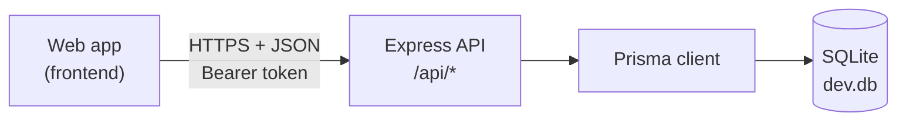
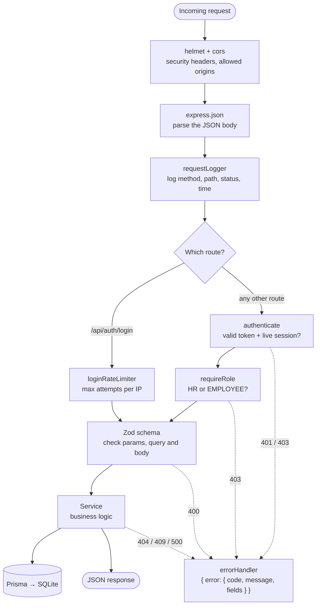
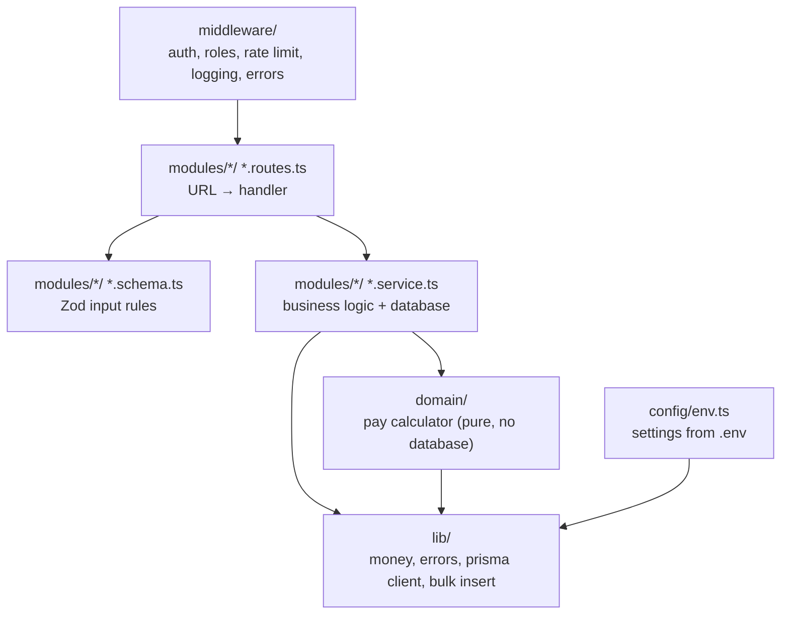
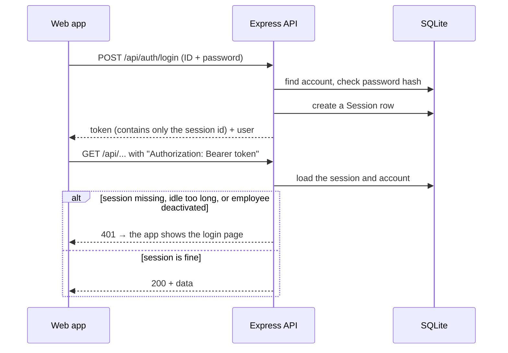
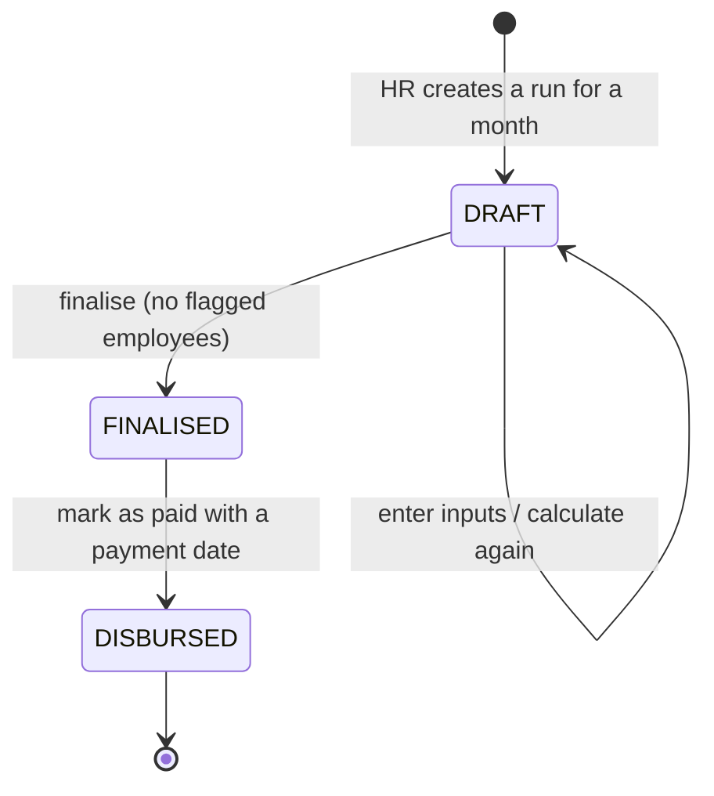

# Backend architecture

A REST API built with **Express**, **Prisma** and **SQLite**. The diagrams below render on GitHub and in VS Code's
Markdown preview.

## 1. The big picture

One process serves every request. All data lives in a single SQLite file.

## 2. What happens to a request

Every request passes through the same steps, top to bottom.

Any step can throw. The single `errorHandler` turns every error into the same JSON shape, so the frontend always knows
how to read it.

## 3. How the code is organised

| Folder         | What it holds                                                                 |
| -------------- | ----------------------------------------------------------------------------- |
| `modules/`     | One folder per feature: `auth`, `employees`, `payroll`, `me`, `insights`, ... |
| `domain/`      | The salary rules. Pure functions, so they are easy to test.                   |
| `middleware/`  | Steps shared by many routes (see diagram 2).                                  |
| `lib/`         | Small helpers: exact money maths, error types, the Prisma client.             |
| `config/`      | Reads and checks environment variables at startup.                            |
| `prisma/`      | Database schema, migrations and the seed script.                              |

### API modules

| Module       | Base path           | Who can use it | What it does                                       |
| ------------ | ------------------- | -------------- | -------------------------------------------------- |
| `auth`       | `/api/auth`         | Everyone       | Log in, log out, current user, change password     |
| `employees`  | `/api/employees`    | HR             | List, add, edit, deactivate, reset password        |
| `structures` | `/api/structures`   | HR             | Salary structures per country                      |
| `countries`  | `/api/countries`    | HR             | Supported countries and their currencies           |
| `payroll`    | `/api/payroll-runs` | HR             | Monthly payroll runs and their payslips            |
| `insights`   | `/api/insights`     | HR             | Salary statistics per country and job title        |
| `me`         | `/api/me`           | Employee       | The logged-in employee's profile and payslips only |

## 4. Logging in and staying logged in

The token only carries a session id. Role and status are read from the database on every request, so logging out,
deactivating an employee or resetting a password takes effect immediately.

## 5. A payroll run's life

- **Draft:** pay can be recalculated as often as needed. Employees cannot see it yet.
- **Finalised:** payslips are issued and become visible to employees. They never change again.
- **Disbursed:** payslips show as **Paid** with the payment date.

A run only moves forward. Finalising happens in one database transaction, so it either completes fully or changes
nothing.
