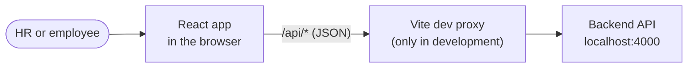
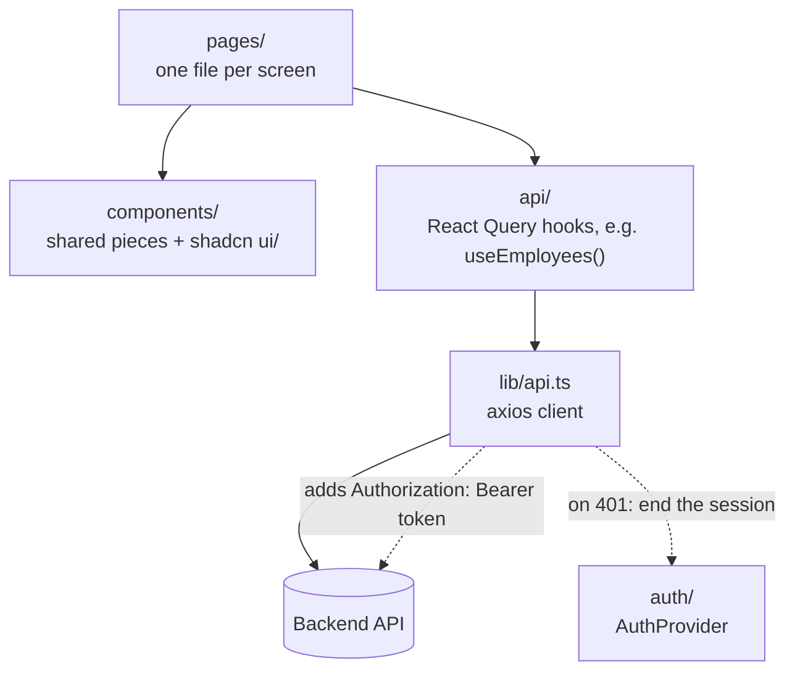
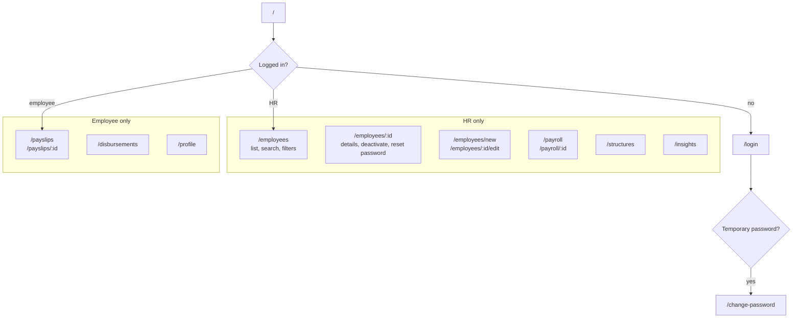
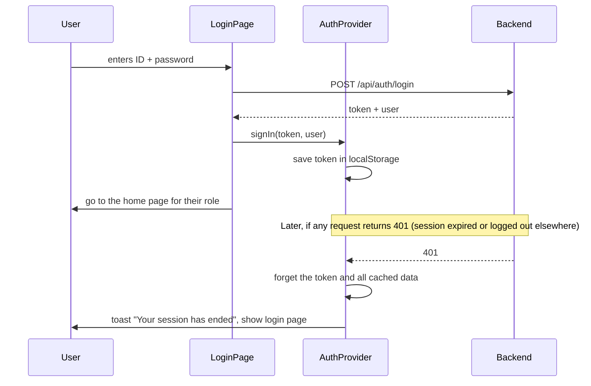
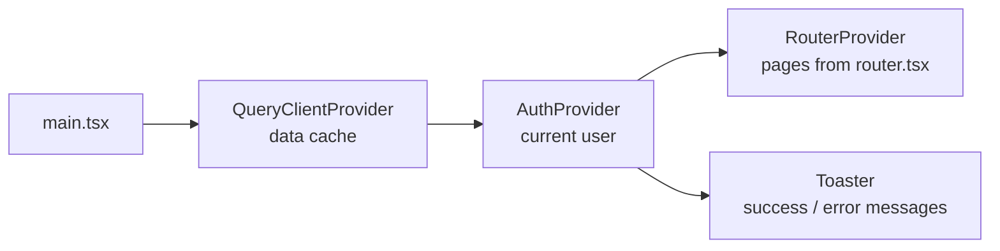

# Frontend architecture

A single-page web app built with **React**, **Vite**, **Tailwind CSS** and **shadcn/ui**. Data comes from the backend
API through **axios** and **TanStack Query** (React Query). The diagrams below render on GitHub and in VS Code's
Markdown preview.

## 1. The big picture

In development, Vite forwards `/api` calls to the backend on port 4000. In production, set `VITE_API_URL` to the
deployed backend's address when building.

## 2. How a page gets its data

Each layer only talks to the one below it.

| Folder              | What it holds                                                                  |
| ------------------- | ------------------------------------------------------------------------------ |
| `pages/`            | Screens: `LoginPage`, `pages/hr/*` for HR, `pages/employee/*` for employees    |
| `components/`       | Shared building blocks: layout, pay breakdown table, payslip, empty/error states |
| `components/ui/`    | shadcn/ui components, added with the shadcn CLI (don't edit by hand)           |
| `api/`              | One file per backend resource, each with its React Query hooks                 |
| `auth/`             | Who is logged in, login/logout, and the route guard                            |
| `lib/`              | axios client, API types, money and date formatting                             |
| `hooks/`            | Small reusable React hooks                                                     |
| `router.tsx`        | Every URL and which page it shows                                              |
| `main.tsx`          | Starts the app and wraps it in the providers                                   |

React Query caches every response, shows loading and error states, and refreshes data after a change. For example,
saving an employee refreshes the employee list automatically.

## 3. Pages and who can open them

`RequireAuth` guards each group:

- Not logged in → sent to `/login`.
- Still on a temporary password → sent to `/change-password`.
- Wrong role (an employee opening `/employees`) → sent to their own home page.

The backend checks the same rules on every request. Hiding pages is only for convenience, not security.

## 4. Logging in

## 5. Starting the app

